<h1 align="center">Adaptive Load Balancer</h1>

<p align="center">
  <b>A software-defined load balancer that sends every new request to the server that will answer fastest.</b><br>
  Mininet &middot; Open vSwitch &middot; POX controller &middot; Python sockets (TCP and UDP)
</p>

<p align="center">
  
  
  
  
  
  
</p>

<table align="center">
<tr>
<td align="center" width="33%"><h2>2%</h2>of requests reached the slow server,<br>against 33% with round robin</td>
<td align="center" width="33%"><h2>75% lower</h2>UDP latency than round robin<br>(31.8 ms vs 129.5 ms)</td>
<td align="center" width="33%"><h2>4x</h2>UDP throughput of round robin<br>(297.7 vs 74.1 req/s)</td>
</tr>
</table>

> [!TIP]
> Click any screenshot to open it full size. Sections with a small arrow expand when you click them.

## Contents

- [Overview](#overview)
- [Tools and technologies](#tools-and-technologies)
- [How it works](#how-it-works)
- [Project layout](#project-layout)
- [Quick start](#quick-start)
- [How we tested](#how-we-tested)
- [Results](#results)
- [Screenshots](#screenshots)
- [Analysis](#analysis)
- [Troubleshooting](#troubleshooting)
- [Team](#team)

## Overview

Many clients use one service that is hosted on several servers. A static load balancer, such as round robin, gives every
server an equal share and ignores how busy each one is. When the servers are unequal, the slow one builds a queue,
response time rises, and the faster servers sit underused.

This project builds an **adaptive load balancer inside a software-defined network (SDN)**. A controller exposes one
virtual IP (VIP) to the clients and keeps track of every server's load. For each new flow it picks a server from live
load measurements, and it enforces that choice by installing flow rules in the switch.

**Objectives**

- Hide all backend servers behind one VIP, so clients never know which server answers.
- Balance both TCP (reliable, connection-based) and UDP (connectionless) traffic.
- Choose servers from live load reports, not a fixed rotation.
- Compare round robin, least connections and adaptive under identical traffic.
- Show lower latency than the static baseline when the servers are unequal.

### The network at a glance

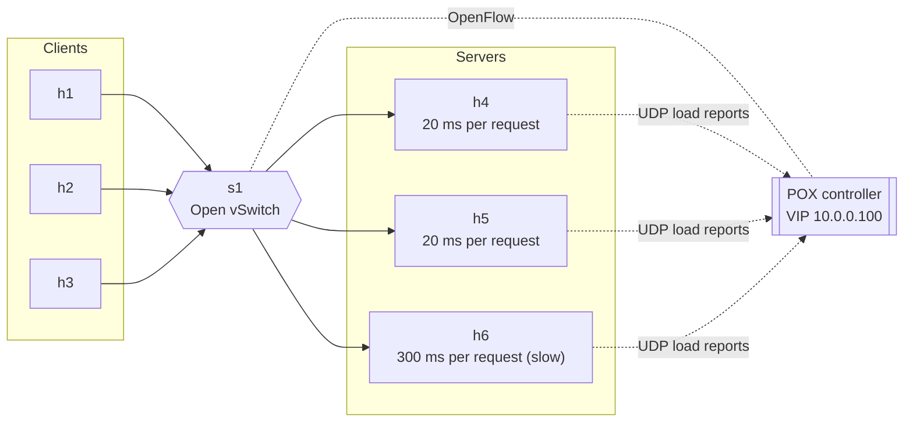

h6 is deliberately slow (0.30 s of work per request against 0.02 s), so the adaptive algorithm has something to adapt to.

## Tools and technologies

| Role | Tool | Why it is used |
|---|---|---|
| Network emulator | **Mininet 2.3.0** | Builds 6 hosts and a switch on one machine, so every experiment is repeatable |
| Switch | **Open vSwitch (OVS)** | A software switch that speaks OpenFlow, so forwarding rules can change while traffic runs |
| SDN controller | **POX 0.7.0** | A Python controller that makes the balancing decisions and installs the flow rules |
| Control protocol | **OpenFlow** | Lets the controller match a flow and rewrite its headers inside the switch |
| Application sockets | **Python 3 `socket` and `threading`** | Low-level TCP and UDP servers and clients, one thread per request |
| Transport | **TCP and UDP** | TCP for reliable request and reply, UDP for low-latency requests and for the load reports |
| Address resolution | **ARP** | The controller answers ARP for the VIP, because no real host owns it |
| Environment | **Ubuntu on WSL2** | Where Mininet, OVS and POX were installed and tested |

## How it works

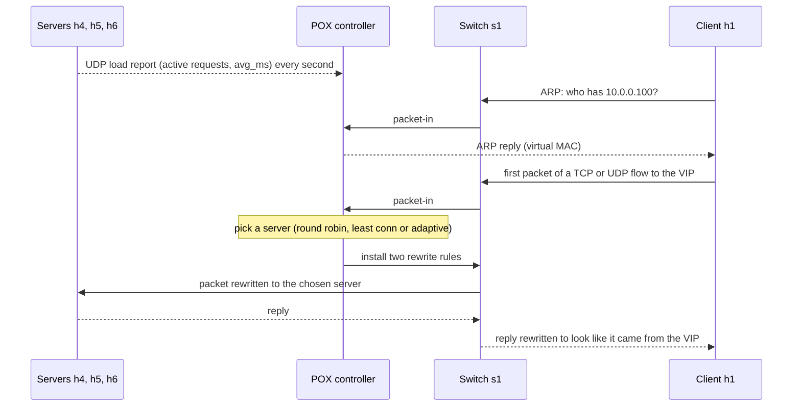

After the two rules are installed, the rest of the flow never touches the controller again.
The load reports are the **socket-to-SDN integration**: servers use plain UDP sockets, and the controller turns what they say into routing decisions.

### Three ways to pick a server

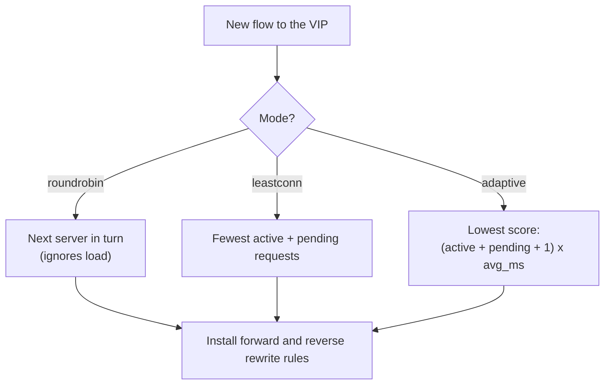

*Active* is how many requests a server is handling right now. *Pending* is how many flows were assigned to it since its last
load report (this stops a whole burst going to one server). *avg_ms* is its moving-average processing time.

<details>
<summary><b>Worked example: why adaptive avoids the slow server</b></summary>

Suppose a new request arrives and the controller last heard this:

| Server | Active | Pending | avg_ms | Score = (active + pending + 1) x avg_ms |
|---|---|---|---|---|
| h4 | 1 | 2 | 20 | (1 + 2 + 1) x 20 = **80** |
| h5 | 2 | 1 | 20 | (2 + 1 + 1) x 20 = **80** |
| h6 | 0 | 0 | 300 | (0 + 0 + 1) x 300 = **300** |

Adaptive picks h4 (lowest score), even though h6 is completely idle. Round robin would have given h6 its turn anyway, and least conn
would have picked h6 because it has the fewest connections. Only the adaptive score knows that a request on h6 takes 15 times longer.

</details>

<details>
<summary><b>How to read a line of the controller log</b></summary>

```
INFO:lb_controller:TCP 10.0.0.1:43268 -> h5 | active=0 pending=3 avg=20ms | totals h4=3 h5=3 h6=0
```

| Part | Meaning |
|---|---|
| `TCP 10.0.0.1:43268` | A new TCP flow from client h1, source port 43268 |
| `-> h5` | The controller chose server h5 |
| `active=0 pending=3 avg=20ms` | What the controller knew about h5 when it chose |
| `totals h4=3 h5=3 h6=0` | How many flows each server has been given so far |

</details>

## Project layout

```
.
├── server.py                 TCP and UDP backend, sends load reports (runs on h4, h5, h6)
├── client.py                 Load generator, prints per-server counts, latency, throughput
├── topology.py               Mininet topology: switch s1 and hosts h1 to h6, starts the servers
├── controller/
│   └── lb_controller.py      POX load balancer (copy into pox/ext/ to run)
└── docs/
    ├── charts/               Charts built from the measured results
    └── screenshots/          Output screenshots for every mode and test case
```

<details>
<summary><b>What each file does</b></summary>

| File | What it does |
|---|---|
| `server.py` | Serves TCP on port 5000 and UDP on port 5001, one thread per request. Simulates work with a delay, tracks active requests and a moving-average processing time, and sends both to the VIP every second. Replies with its own name so the client can see who answered |
| `client.py` | Sends many requests to the VIP over TCP or UDP with parallel workers. Options: `-n` total requests, `-c` workers, `--proto tcp` or `--proto udp`. Prints requests answered per server, failures, average latency, total time and throughput |
| `topology.py` | Builds one switch and six hosts with fixed MAC addresses and static ARP entries, connects the switch to the POX controller, and starts the servers on h4, h5, h6 with delays of 0.02, 0.02 and 0.30 s |
| `controller/lb_controller.py` | Answers ARP for the VIP, reads the servers' load reports, selects a server with the chosen algorithm, installs the forward and reverse rewrite rules, and logs every decision with running totals |

</details>

| Item | Value |
|---|---|
| Virtual IP | `10.0.0.100` (no real host owns it) |
| Clients | h1, h2, h3 (`10.0.0.1` to `10.0.0.3`); tests are run from h1 |
| Servers | h4, h5, h6 (`10.0.0.4` to `10.0.0.6`) |
| Ports | TCP `5000`, UDP `5001`, load reports to the VIP on UDP `9999` |

## Quick start

<details open>
<summary><b>Install and run</b></summary>

```bash
# Prerequisites
sudo apt install -y mininet openvswitch-switch git
git clone https://github.com/noxrepo/pox ~/pox

# 1. Put the controller where POX can load it
cp controller/lb_controller.py ~/pox/ext/

# 2. Make sure Open vSwitch is running
sudo service openvswitch-switch start

# 3. Terminal 1: start the controller (LB_MODE = roundrobin, leastconn or adaptive)
cd ~/pox
LB_MODE=adaptive python3 pox.py lb_controller

# 4. Terminal 2: start the network, from this repository's folder
sudo mn -c
sudo python3 topology.py
```

Start the controller first, then the network. At the `mininet>` prompt, run the three test cases:

```
h1 python3 client.py -n 20 -c 2
h1 python3 client.py -n 300 -c 10
h1 python3 client.py --proto udp -n 300 -c 10
```

To test another mode: type `exit`, press Ctrl+C in Terminal 1, and repeat from step 3 with a different `LB_MODE`.
To clean up: `exit`, then `sudo mn -c`.

</details>

## How we tested

The same three test cases were run, one after another, for each of the three algorithms: **nine runs** on the same topology.

| # | Test case | Command (from h1) | Why |
|---|---|---|---|
| 1 | TCP, light load | `client.py -n 20 -c 2` | Does every mode work end to end, and how does each behave on a small load |
| 2 | TCP, heavy load | `client.py -n 300 -c 10` | Many parallel connections, so server load matters |
| 3 | UDP, heavy load | `client.py --proto udp -n 300 -c 10` | The same load over connectionless traffic |

| Metric | Meaning |
|---|---|
| Requests per server | How many requests h4, h5 and h6 each answered, which shows how evenly load was spread |
| Failed requests | Requests that got no answer |
| Average latency | Average time for a request to get its reply, as printed by `client.py` |
| Total time | Time from the first request to the end of the run |
| Throughput | Answered requests divided by total time |

## Results

### Scoreboard: average latency (lower is better)

| Test | 1st | 2nd | 3rd |
|---|---|---|---|
| TCP, 20 requests | 🥇 Adaptive 92.4 ms | 🥈 Least conn 190.2 ms | 🥉 Round robin 192.3 ms |
| TCP, 300 requests | 🥇 Adaptive 44.8 ms | 🥈 Least conn 125.4 ms | 🥉 Round robin 140.8 ms |
| UDP, 300 requests | 🥇 Adaptive 31.8 ms | 🥈 Least conn 116.8 ms | 🥉 Round robin 129.5 ms |

<p align="center">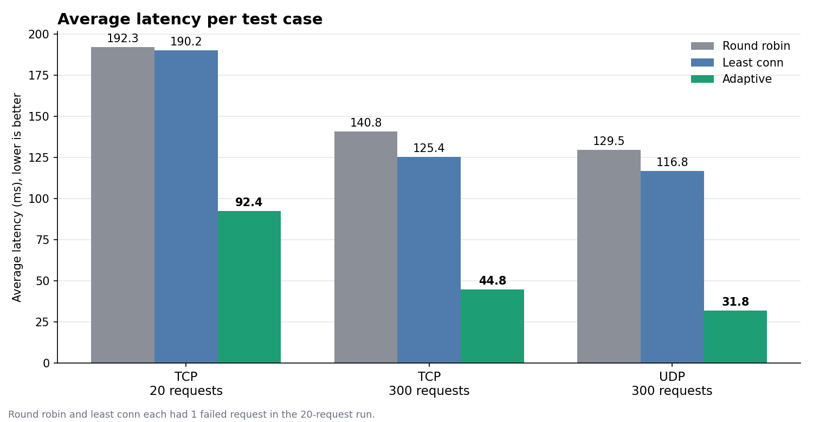</p>

<p align="center">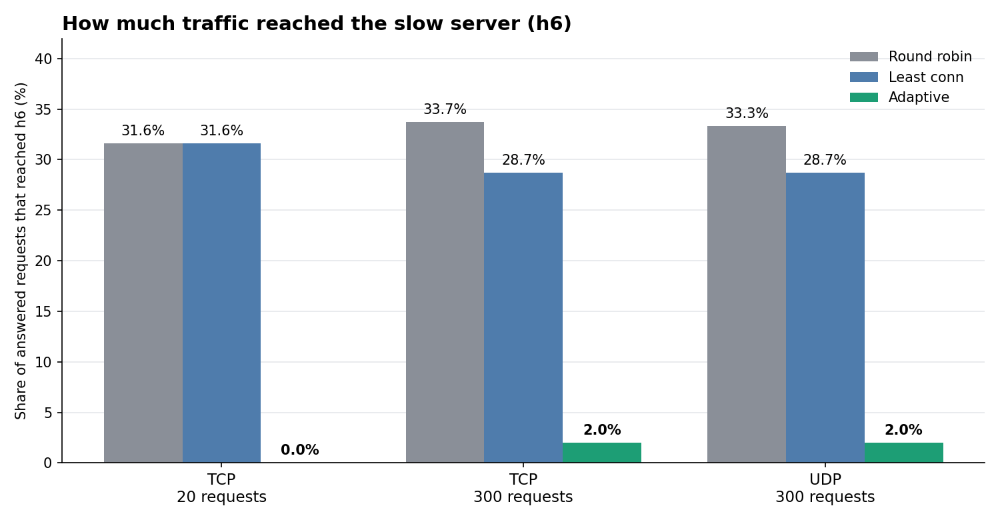</p>

<p align="center">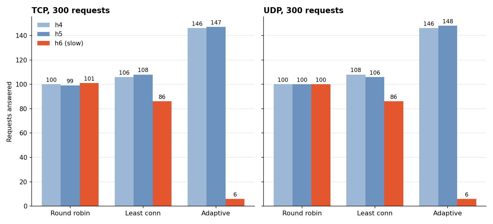</p>

<details>
<summary><b>Full results table</b></summary>

Requests are shown as h4 / h5 / h6.

| Test | Mode | Requests h4 / h5 / h6 | Avg latency | Total time | Throughput |
|---|---|---|---|---|---|
| TCP, 20 requests, 2 workers | **Adaptive** | 10 / 10 / 0 | **92.4 ms** | 0.93 s | 21.6 req/s |
| | Round robin | 7 / 6 / 6 (1 failed) | 192.3 ms | 10.01 s* | 1.9 req/s* |
| | Least conn | 7 / 6 / 6 (1 failed) | 190.2 ms | 10.01 s* | 1.9 req/s* |
| TCP, 300 requests, 10 workers | **Adaptive** | 146 / 147 / 6 (1 failed) | **44.8 ms** | 10.11 s* | 29.6 req/s* |
| | Round robin | 100 / 99 / 101 | 140.8 ms | 4.39 s | 68.3 req/s |
| | Least conn | 106 / 108 / 86 | 125.4 ms | 3.92 s | 76.6 req/s |
| UDP, 300 requests, 10 workers | **Adaptive** | 146 / 148 / 6 | **31.8 ms** | **1.01 s** | **297.7 req/s** |
| | Round robin | 100 / 100 / 100 | 129.5 ms | 4.05 s | 74.1 req/s |
| | Least conn | 108 / 106 / 86 | 116.8 ms | 3.64 s | 82.3 req/s |

\* The run included one failed request. Every such run shows a total time of about 10 s, which is consistent with the client waiting for a timeout, so the throughput of these runs is not comparable with the others.

</details>

## Screenshots

Each screenshot shows the controller log (top terminal) and the client output (bottom terminal) for one run. Click one to enlarge it.

### Test 1: TCP, 20 requests, 2 workers

<table>
<tr><th align="center">Adaptive</th><th align="center">Round robin</th><th align="center">Least connections</th></tr>
<tr>
<td><a href="docs/screenshots/adaptive_tcp20.png">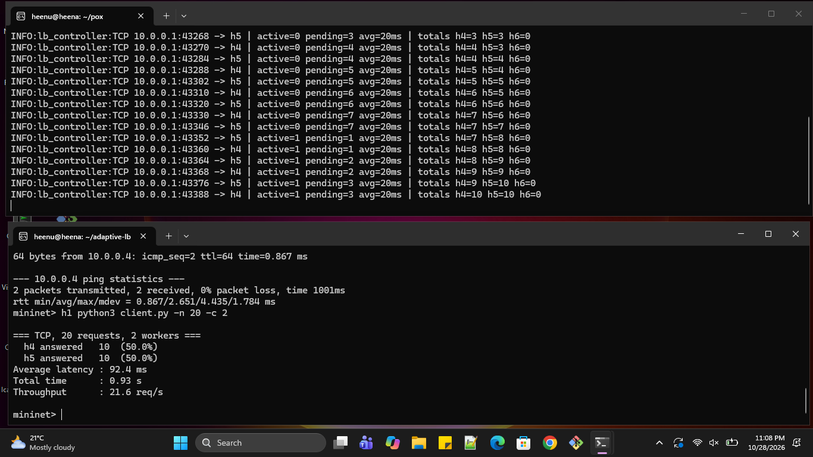</a></td>
<td><a href="docs/screenshots/roundrobin_tcp20.png">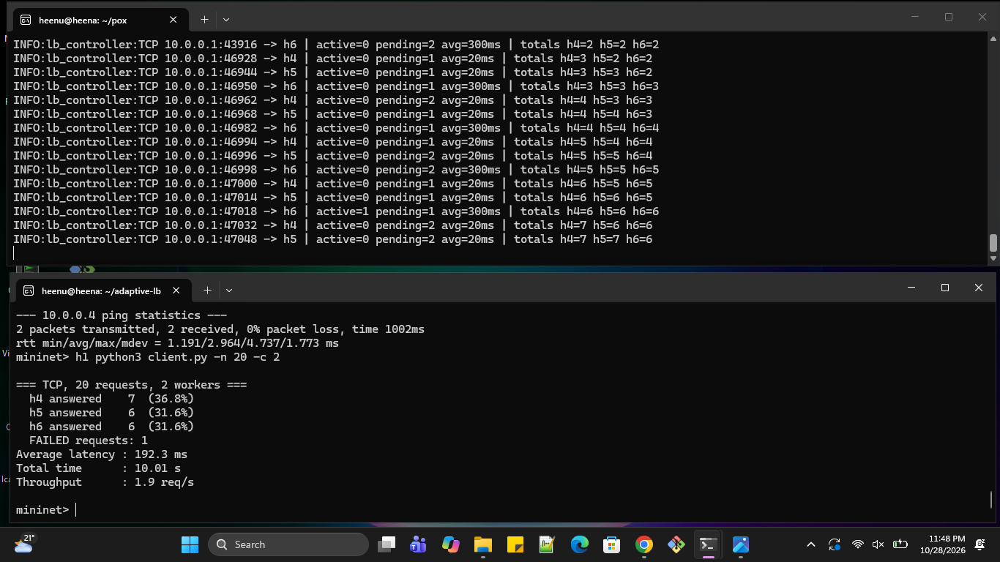</a></td>
<td><a href="docs/screenshots/leastconn_tcp20.png">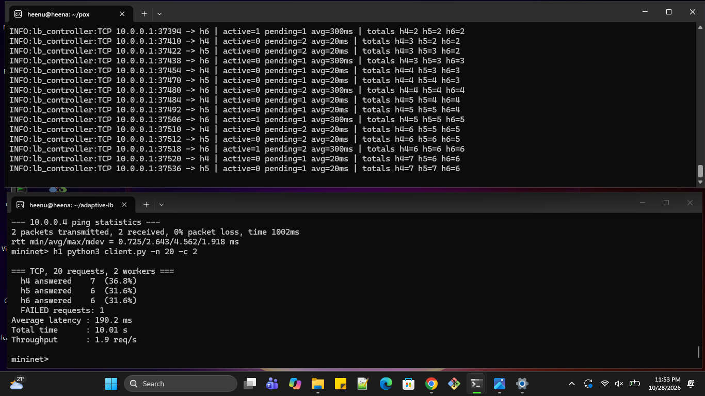</a></td>
</tr>
<tr>
<td align="center">h6 got <b>0</b> of 20<br>92.4 ms</td>
<td align="center">h6 got 6<br>192.3 ms (1 failed)</td>
<td align="center">h6 got 6<br>190.2 ms (1 failed)</td>
</tr>
</table>

### Test 2: TCP, 300 requests, 10 workers

<table>
<tr><th align="center">Adaptive</th><th align="center">Round robin</th><th align="center">Least connections</th></tr>
<tr>
<td><a href="docs/screenshots/adaptive_tcp300.png">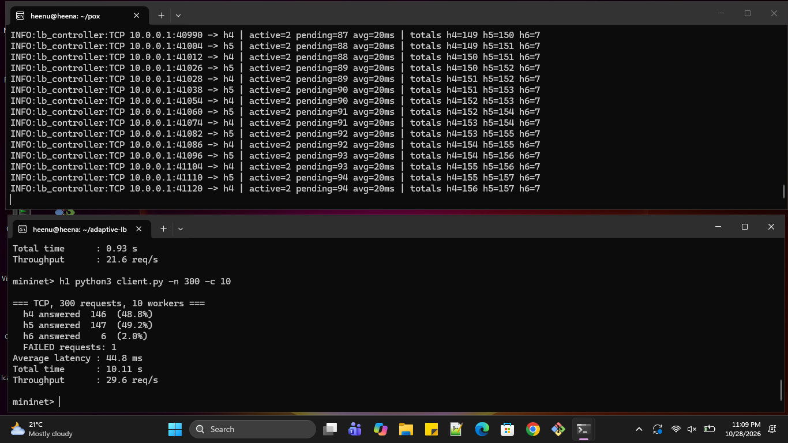</a></td>
<td><a href="docs/screenshots/roundrobin_tcp300.png">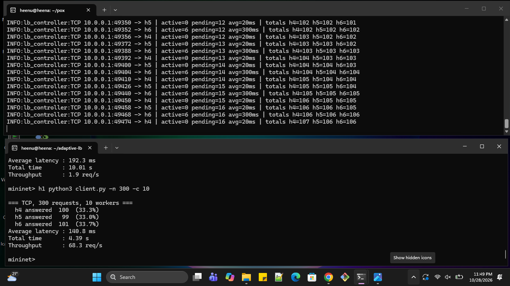</a></td>
<td><a href="docs/screenshots/leastconn_tcp300.png">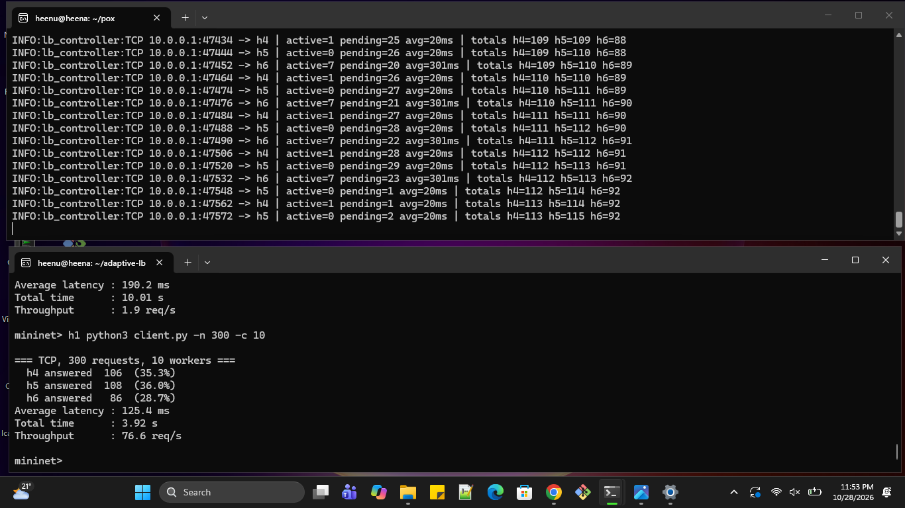</a></td>
</tr>
<tr>
<td align="center">h6 got <b>6</b> of 300<br>44.8 ms (1 failed)</td>
<td align="center">h6 got 101<br>140.8 ms</td>
<td align="center">h6 got 86<br>125.4 ms</td>
</tr>
</table>

### Test 3: UDP, 300 requests, 10 workers

<table>
<tr><th align="center">Adaptive</th><th align="center">Round robin</th><th align="center">Least connections</th></tr>
<tr>
<td><a href="docs/screenshots/adaptive_udp300.png">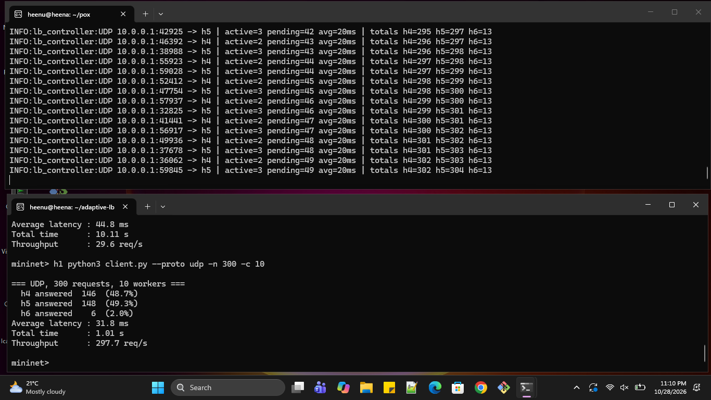</a></td>
<td><a href="docs/screenshots/roundrobin_udp300.png">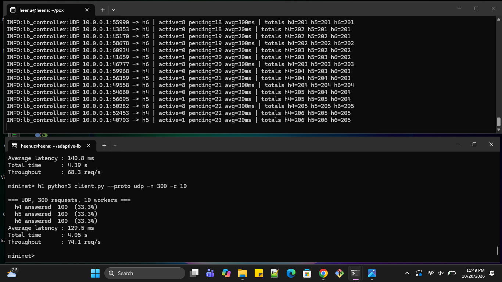</a></td>
<td><a href="docs/screenshots/leastconn_udp300.png">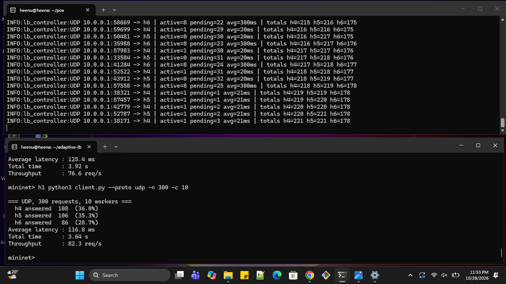</a></td>
</tr>
<tr>
<td align="center">h6 got <b>6</b> of 300<br>31.8 ms</td>
<td align="center">h6 got 100<br>129.5 ms</td>
<td align="center">h6 got 86<br>116.8 ms</td>
</tr>
</table>

## Analysis

**Adaptive keeps traffic off the slow server.** With 300 requests, adaptive sent only 6 (2%) to h6 over both TCP and UDP. Round robin sent about a third because it ignores load, and least conn still sent about 29%.

**Adaptive had the lowest average latency in every test.**

| Test | Adaptive | Round robin | Least conn | Adaptive vs round robin |
|---|---|---|---|---|
| TCP, 300 requests | 44.8 ms | 140.8 ms | 125.4 ms | 68% lower |
| UDP, 300 requests | 31.8 ms | 129.5 ms | 116.8 ms | 75% lower |
| TCP, 20 requests | 92.4 ms | 192.3 ms | 190.2 ms | 52% lower |

**On UDP, adaptive also had about 4x the throughput** of round robin (297.7 vs 74.1 req/s) and about 3.6x that of least conn (82.3 req/s). It finished 300 requests in 1.01 s against about 4 s.

**Least conn sits in between.** It beat round robin slightly because it reacts to how many connections a server holds. It still sent about 29% to h6, because it counts connections rather than how slow each server is. Adaptive multiplies load by each server's measured processing time, so it recognises h6 as slow right away.

<details>
<summary><b>The startup effect and the 10 s totals</b></summary>

- **Startup.** Adaptive starts evenly until the first load reports arrive (about one second), so a few requests still reached h6 at the start of the 300-request runs.
- **The 10 s totals.** The adaptive TCP 300 run, and the round robin and least conn 20-request runs, each had one failed request and a total time of about 10 s. These look like a client timeout rather than server capacity, so their throughput should not be compared.
- **Where the adaptive failure went.** The controller log counts 7 assignments to h6 against 6 answered requests, so the failed request was most likely sent to h6 during the startup window.

</details>

<details>
<summary><b>Limitations and possible extensions</b></summary>

**Limitations**

- Each case was run once, so there are no repeated runs or confidence intervals.
- The 20-request runs are dominated by startup effects (first flows, first load reports).
- Mininet runs on one machine, so absolute numbers are not those of a real network. The comparison between modes is the useful part.
- Work on the servers is simulated with a delay, and the topology has one slow server out of three.

**Possible extensions**

- Repeat each run several times and report averages.
- Stop a server mid-run to test failure detection and recovery.
- Vary how slow h6 is, and add more servers.

</details>

## Troubleshooting

<details>
<summary><code>ovs-vsctl: database connection failed</code></summary>

Open vSwitch is not running. Run `sudo service openvswitch-switch start`, then `sudo mn -c`.

</details>

<details>
<summary>Ping or client requests fail</summary>

The controller must be running before the network starts. Start the controller first, then run `topology.py`.

</details>

<details>
<summary><code>Address already in use</code> on port 5000 or 5001</summary>

Stale servers from an earlier run. Run `sudo mn -c` and `sudo pkill -f server.py`, then start again.

</details>

<details>
<summary>The client prints FAILED requests right after start</summary>

Wait two or three seconds after Mininet starts so the servers can begin reporting, then retry.

</details>

<details>
<summary>I changed the number of servers and nothing balances</summary>

Update the server table in the controller and the host setup in `topology.py` so they match.

</details>

## Team

Heena JK, Hiten T, Sidhartha Kedlaya

<p align="center"><sub>Computer Networks (UE25CS243A) &middot; Jackfruit Mini Project &middot; SDN + Socket Programming</sub></p>
